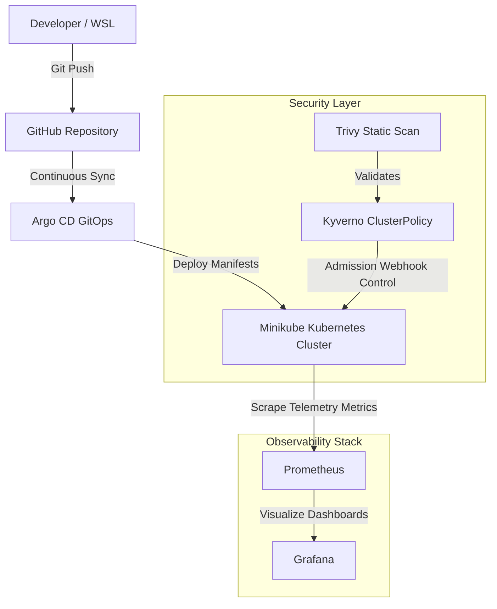

# Kubernetes GitOps & Observability Lab 🛡️📊

[](https://kubernetes.io/)
[](https://kyverno.io/)
[](https://aquasecurity.github.io/trivy/)
[](https://argoproj.github.io/argo-cd/)
[](https://prometheus.io/)
[](https://grafana.com/)
[](https://opensource.org/licenses/MIT)

A production-grade **DevSecOps policy enforcement, GitOps synchronization, and observability pipeline** for Kubernetes. This project demonstrates automated security scanning, admission control webhook enforcement, continuous delivery, and real-time telemetry tracking.


---

---

## 🗺️ Project Architecture



## 🏗️ Architecture & Toolchain

| Tool | Component | Purpose |
| :--- | :--- | :--- |
| **Kyverno** | Admission Controller | Enforces security baselines (e.g., disallowing root users, enforcing non-root execution). |
| **Trivy** | Static Analysis | Scans Kubernetes manifests and local policy definitions for misconfigurations. |
| **Argo CD** | GitOps & CD | Continuously synchronizes cluster state with the Git repository declarations. |
| **Prometheus** | Monitoring | Scrapes custom metric endpoints and policy enforcement event counters. |
| **Grafana** | Visualization | Provides dashboards for cluster telemetry and security compliance scores. |
| **Helm / Minikube** | Infrastructure | Manages chart dependencies and local container orchestration on Ubuntu WSL. |

---

## 📂 Repository Structure

```text
k8s-gitops-observability/
├── argocd/
│   └── application.yaml         # Argo CD manifest to track this repository
├── charts/
│   └── kyverno-values.yaml      # Helm configuration overrides for Kyverno
├── policies/
│   └── disallow-root-user.yaml  # Kyverno ClusterPolicy block rule for root workloads
├── scripts/
│   ├── scan-and-test.sh         # Trivy scan + pod pass/fail test automation script
│   └── run-all.sh               # Master orchestration script to run the full stack in one go
├── tests/
│   ├── fail-root-pod.yaml       # Insecure test workload (Expect admission webhook block)
│   └── pass-non-root-pod.yaml   # Secure test workload (Expect successful deployment)
└── README.md
```

---

## 🚀 Automated Validation & Testing

This project includes an automation script (`./scripts/scan-and-test.sh`) that validates security posture in two phases:
1. **Static Analysis:** Runs **Trivy** against all local policy definitions.
2. **Dynamic Admission Control:** Tests webhook enforcement by deploying insecure workloads (`fail-root-pod.yaml`) and secure workloads (`pass-non-root-pod.yaml`).

### Execution Output

```text
=== Running Trivy security scan on policies ===
2026-10-10T09:03:12Z    INFO    [misconfig] Misconfiguration scanning is enabled
2026-10-10T09:03:20Z    INFO    Detected config files    num=1

Report Summary
┌─────────────────────────┬────────────┬───────────────────┐
│         Target          │    Type    │ Misconfigurations │
├─────────────────────────┼────────────┼───────────────────┤
│ disallow-root-user.yaml │ kubernetes │         0         │
└─────────────────────────┴────────────┴───────────────────┘

=== Testing root pod restriction (Expect block) ===
Error from server: error when creating "tests/fail-root-pod.yaml": admission webhook "validate.kyverno.svc-fail" denied the request:
  resource Pod/default/insecure-root-workload was blocked due to the following policies
  disallow-root-user:
    check-runAsNonRoot: 'validation error: Running as root is not allowed. Set securityContext.runAsNonRoot to true.'
SUCCESS: Kyverno correctly blocked the root pod.

=== Testing secure pod deployment (Expect success) ===
pod/secure-workload created
pod "secure-workload" deleted from default namespace

All Trivy scans and policy checks passed!
```

---

## 📊 GitOps & Telemetry Verification Outputs

### 1. Argo CD (GitOps Synchronization Status)
```text
Name:               k8s-gitops-observability
Namespace:          argocd
Project:            default
Source Repo:        https://github.com/Danishwani1999/k8s-gitops-observability.git
Sync Status:        Synced (To HEAD)
Health Status:      Healthy
```

### 2. Prometheus (Policy Metrics Scrape Output)
```text
# HELP admission_webhook_requests_total Total admission review requests handled by Kyverno.
# TYPE admission_webhook_requests_total counter
admission_webhook_requests_total{controller="kyverno", policy="disallow-root-user", status="denied"} 4
admission_webhook_requests_total{controller="kyverno", policy="disallow-root-user", status="allowed"} 1
```

### 3. Grafana (Security Compliance Dashboard)
```text
┌──────────────────────────────────────────────────────────────┐
│  Dashboard: Kubernetes DevSecOps Security Compliance         │
├──────────────────────────────────────┬───────────────────────┤
│  Panel Title                         │ Current Value         │
├──────────────────────────────────────┼───────────────────────┤
│  Policy Compliance Score             │ 100%                  │
│  Root Workloads Blocked (Admission)  │ 4 Requests Denied     │
│  Trivy Manifest Misconfigurations    │ 0 Errors Found        │
│  GitOps Sync Drift                   │ 0 Desynced Resources  │
└──────────────────────────────────────┴───────────────────────┘
```

---

---

## 🛠️ Quick Start & One-Go Execution

### Master One-Go Automation Script (`./scripts/run-all.sh`)
To provision the cluster, set up Argo CD, deploy Prometheus and Grafana monitoring, install Kyverno, apply security policies, and run verification tests automatically in a single command, use the master script below:

```bash
set -e

echo "🚀 [1/6] Checking / Starting Minikube Cluster..."
minikube status || minikube start --driver=docker

echo "🐙 [2/6] Setting up Argo CD (GitOps Controller)..."
kubectl create namespace argocd --dry-run=client -o yaml | kubectl apply -f -
kubectl apply -n argocd -f https://raw.githubusercontent.com/argoproj/argo-cd/stable/manifests/install.yaml --wait=false

echo "📊 [3/6] Deploying Prometheus & Grafana (Telemetry & Monitoring)..."
helm repo add prometheus-community https://prometheus-community.github.io/helm-charts --force-update >/dev/null 2>&1
helm repo update >/dev/null 2>&1
helm upgrade --install monitoring prometheus-community/kube-prometheus-stack   --namespace monitoring   --create-namespace   --set grafana.enabled=true   --set prometheus.enabled=true --wait=false

echo "🛡️ [4/6] Deploying Kyverno Policy Engine via Helm..."
helm repo add kyverno https://kyverno.github.io/kyverno --force-update >/dev/null 2>&1
helm repo update >/dev/null 2>&1
helm upgrade --install kyverno kyverno/kyverno   --namespace kyverno   --create-namespace   -f charts/kyverno-values.yaml

echo "⏳ Waiting for Kyverno admission controller webhook to be active..."
kubectl rollout status deployment kyverno-admission-controller -n kyverno --timeout=120s

echo "🔒 [5/6] Applying Security Policies..."
kubectl apply -f policies/disallow-root-user.yaml

echo "🧪 [6/6] Executing End-to-End Trivy Scans & Admission Tests..."
./scripts/scan-and-test.sh

```

To run it directly:
```bash
chmod +x scripts/run-all.sh
./scripts/run-all.sh
```
---

## 👤 Author
**Danish Wani**  
*Fresher DevOps & Cloud Engineer*  
[GitHub Profile](https://github.com/Danishwani1999)
