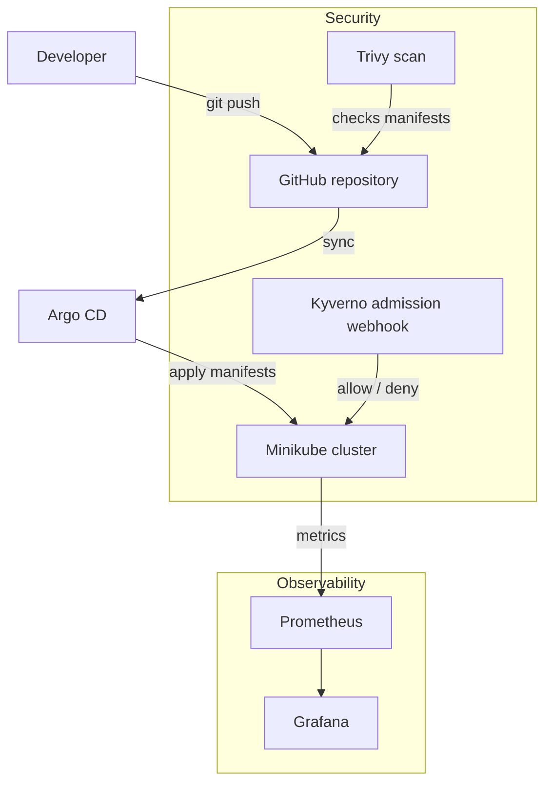
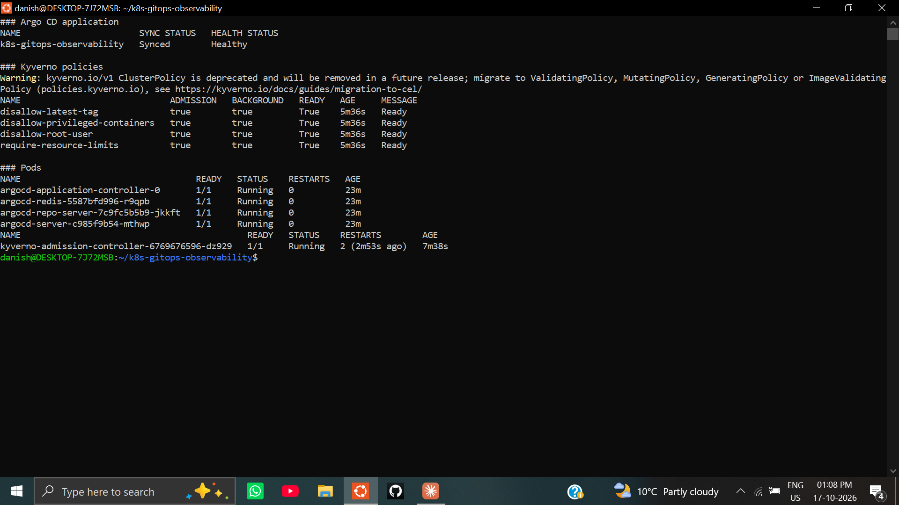
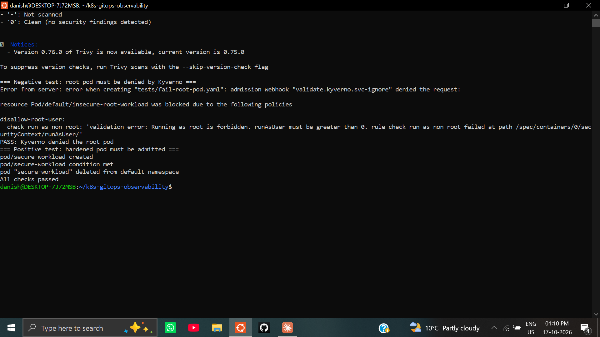
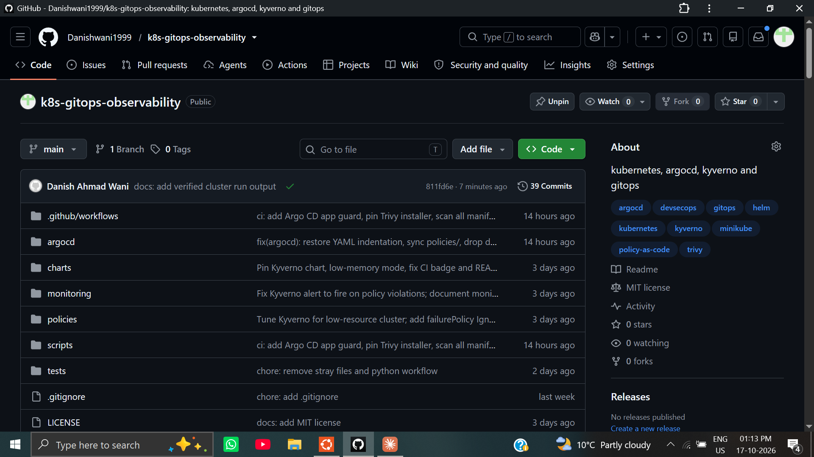

# Kubernetes GitOps & Policy Enforcement Lab

A local Kubernetes lab that combines **policy-as-code admission control (Kyverno)**, **manifest scanning (Trivy)**, **GitOps delivery (Argo CD)** and **metrics/dashboards (Prometheus + Grafana)**. Everything runs on a single Minikube cluster, and one script provisions and verifies it.


> **Scope:** this is a learning and demonstration environment on Minikube, not a production reference architecture. See [Limitations](#limitations-and-roadmap).

---

## What this demonstrates

- **Shift-left security:** Trivy scans Kubernetes manifests before they reach the cluster.
- **Admission control:** a Kyverno `ClusterPolicy` rejects pods that run as root, and a test suite proves both the deny and allow paths.
- **GitOps:** an Argo CD `Application` tracks this repository and reports sync and health status.
- **Observability:** kube-prometheus-stack provides Prometheus and Grafana for cluster and policy metrics.
- **Repeatability:** one script builds the environment, applies policies and runs the tests.

## Architecture



| Tool | Role |
|---|---|
| Kyverno | Admission controller enforcing security policies |
| Trivy | Static misconfiguration scanning |
| Argo CD | Declarative GitOps delivery and drift detection |
| Prometheus / Grafana | Metrics collection and dashboards (kube-prometheus-stack) |
| Helm | Installs Kyverno and the monitoring stack |
| Minikube | Local Kubernetes cluster (Docker driver) |

## Repository structure

```text
├── argocd/application.yaml     # Argo CD Application (syncs policies/)
├── charts/kyverno-values.yaml  # Low-resource Kyverno values
├── policies/                   # Kyverno ClusterPolicies
├── monitoring/                 # Kyverno ServiceMonitor and alert
├── scripts/                    # run-all.sh, scan-and-test.sh
├── tests/                      # Test pods and Kyverno CLI tests
└── .github/workflows/ci.yml    # Kyverno tests, Trivy, kubeconform, Argo CD app check
```

## The policy

`disallow-root-user` (Enforce) blocks pods and containers that
explicitly set `runAsUser: 0`. Pods that set no user at all are not
caught by this rule. It uses `failurePolicy: Ignore`, so if the Kyverno
webhook is down, pods are admitted instead of blocked. That is a
deliberate low-resource tradeoff for Minikube and should be `Fail` in
production. The other three policies run in Audit mode.

## Prerequisites

- Linux, macOS, or WSL2 (Ubuntu)
- Docker, Minikube, `kubectl`, Helm 3, Trivy
- About 4 CPUs and 8 GB RAM free for the cluster

## Quick start

```bash
git clone https://github.com/Danishwani1999/k8s-gitops-observability.git
cd k8s-gitops-observability
chmod +x scripts/*.sh
./scripts/run-all.sh
```

`run-all.sh` performs these steps:

1. Starts Minikube if it is not running.
2. Installs Argo CD into the `argocd` namespace.
3. Installs kube-prometheus-stack (Prometheus and Grafana) into `monitoring`.
4. Installs Kyverno with `charts/kyverno-values.yaml` and waits for the admission controller.
5. Applies the policies in `policies/`.
6. Runs `scripts/scan-and-test.sh`.

## Validation

`scripts/scan-and-test.sh` runs two phases:

1. **Static scan:** Trivy scans the repository manifests for misconfigurations.
2. **Admission test:** applies `fail-root-pod.yaml` and expects a rejection, then applies `pass-non-root-pod.yaml` and expects success.

The script exits non-zero if either expectation is not met, so it can be used as a CI gate.

### Example output (abridged)

```text
=== Running Trivy security scan ===
...
=== Testing root pod restriction (expect block) ===
SUCCESS: Kyverno correctly blocked the root pod.

=== Testing secure pod deployment (expect success) ===
pod/secure-workload created
All checks passed.
```

## GitOps with Argo CD

`argocd/application.yaml` registers this repository with Argo CD.

```bash
kubectl apply -f argocd/application.yaml
kubectl -n argocd get applications
kubectl -n argocd port-forward svc/argocd-server 8080:443
# Admin password:
kubectl -n argocd get secret argocd-initial-admin-secret -o jsonpath="{.data.password}" | base64 -d
```

The Argo CD `Application` syncs only `policies/` to the cluster, so `tests/` is never deployed.

## Observability

```bash
kubectl -n monitoring port-forward svc/monitoring-grafana 3000:80
kubectl -n monitoring port-forward svc/monitoring-kube-prometheus-prometheus 9090:9090
```

Kyverno exposes policy metrics that Prometheus can scrape. Example queries (confirm exact names against your Kyverno version at `/metrics`):

```promql
sum by (policy_name, rule_result) (kyverno_policy_results_total)
sum(rate(kyverno_admission_requests_total[5m]))
```

Kyverno exposes native Prometheus metrics (such as policy results and admission request totals) which are scraped by the monitoring stack. You can visualize admission counts and policy enforcement rates in Grafana.


## Cleanup

```bash
minikube delete
```

## Limitations and roadmap

- Local Minikube only. Argo CD manages `policies/`, not an application.
- Kyverno and monitoring are installed by script, not by Argo CD.
- The root-user policy only catches an explicit `runAsUser: 0`.
- It uses `failurePolicy: Ignore` (fail-open) for low-resource Minikube.
- Trivy scans the compliant test pod and the policy, Argo CD and monitoring manifests; container images are not scanned.

Next steps:

- [ ] Deploy a sample app through Argo CD
- [ ] Move Kyverno and monitoring into Argo CD Applications
- [ ] Require `runAsNonRoot` and set `failurePolicy: Fail`
- [ ] Scan container images in CI

## Author

**Danish Wani** · Fresher DevOps & Cloud Engineer
GitHub: [@Danishwani1999](https://github.com/Danishwani1999)

## License

MIT. See [LICENSE](LICENSE).

## Verified run

Minikube (3 CPU, 4 GB), Kyverno chart 3.9.1 (Kyverno v1.19.1), Argo CD v2.13.3, 2026-10-17

```text
NAME                       SYNC STATUS   HEALTH STATUS
k8s-gitops-observability   Synced        Healthy

NAME                             ADMISSION   BACKGROUND   READY   AGE     MESSAGE
disallow-latest-tag              true        true         True    2m56s   Ready
disallow-privileged-containers   true        true         True    2m56s   Ready
disallow-root-user               true        true         True    2m56s   Ready
require-resource-limits          true        true         True    2m56s   Ready
```

## Screenshots

Argo CD synced and policies loaded:



Kyverno denies the root pod, admits the hardened pod:



GitHub Actions CI:


