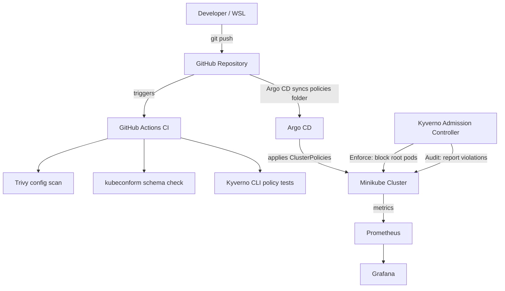

# Kubernetes GitOps & Observability Lab 🛡️📊

[](https://github.com/Danishwani1999/k8s-gitops-observability/actions/workflows/ci.yml)
[](https://kubernetes.io/)
[](https://kyverno.io/)
[](https://aquasecurity.github.io/trivy/)
[](https://argoproj.github.io/argo-cd/)
[](https://prometheus.io/)
[](https://grafana.com/)
[](https://opensource.org/licenses/MIT)

A hands-on **DevSecOps lab** on Minikube that combines Kubernetes admission control (Kyverno), policy-as-code managed through GitOps (Argo CD), automated CI checks (GitHub Actions with Trivy, kubeconform and Kyverno tests) and a monitoring stack (Prometheus and Grafana).

Every result shown in this README was captured from a real run of this repository.

---

## 🗺️ Architecture



**How the pieces fit**

- **CI** validates every push and pull request before changes are trusted.
- **Argo CD** syncs the `policies/` folder from `main` to the cluster, with `prune` and `selfHeal` enabled. Deleting a policy by hand makes Argo CD restore it from Git.
- **Kyverno** enforces or audits the policies at admission time and exposes `kyverno_policy_results_total` metrics.
- **Prometheus and Grafana** (kube-prometheus-stack) are installed with Helm by `scripts/run-all.sh`.

---

## 🛡️ Policies

| Policy | Mode | What it does |
| --- | --- | --- |
| `disallow-root-user` | **Enforce** | Blocks pods unless `securityContext.runAsNonRoot` is `true`. |
| `disallow-latest-tag` | Audit | Flags images without a tag or using `:latest`. |
| `require-resource-limits` | Audit | Flags containers without CPU and memory limits. |
| `disallow-privileged-containers` | Audit | Flags privileged containers. |

The three newer policies run in **Audit** mode on purpose: they report violations without blocking anything, so existing system pods in `argocd` and `monitoring` are not disrupted.

---

## 🧰 Toolchain

| Tool | Role | Purpose |
| --- | --- | --- |
| **Kyverno** | Admission controller | Enforces and audits Kubernetes policies. |
| **Trivy** | Static analysis | Scans manifests for misconfigurations in CI and locally. |
| **kubeconform** | Schema validation | Validates Kubernetes manifests in CI. |
| **Argo CD** | GitOps / CD | Keeps cluster policies in sync with this repository. |
| **GitHub Actions** | CI | Runs Trivy, kubeconform and Kyverno policy tests on every push and PR. |
| **Prometheus / Grafana** | Observability | Metrics collection and dashboards. |
| **Helm / Minikube** | Infrastructure | Installs charts and runs a local cluster on Ubuntu (WSL2). |

---

## 📂 Repository Structure

```
k8s-gitops-observability/
├── .github/workflows/
│   └── ci.yml                              # Trivy + kubeconform + Kyverno policy tests
├── argocd/
│   └── application.yaml                     # Argo CD Application syncing policies/ from this repo
├── charts/
│   └── kyverno-values.yaml                  # Helm value overrides for Kyverno
├── policies/
│   ├── disallow-root-user.yaml              # Enforce
│   ├── disallow-latest-tag.yaml             # Audit
│   ├── require-resource-limits.yaml         # Audit
│   └── disallow-privileged-containers.yaml  # Audit
├── scripts/
│   ├── run-all.sh                           # One-go setup of the whole stack
│   └── scan-and-test.sh                     # Trivy scan + live admission tests
├── tests/
│   ├── fail-root-pod.yaml                   # Insecure pod (expected: blocked)
│   ├── pass-non-root-pod.yaml               # Secure pod (expected: created)
│   ├── kyverno-test/
│   │   └── kyverno-test.yaml                # Kyverno CLI unit test for disallow-root-user
│   └── policy-tests/
│       ├── good-pod.yaml                    # Compliant pod for the audit policies
│       ├── bad-pod.yaml                     # Violating pod (unit tests only, never deploy)
│       └── kyverno-test.yaml                # Kyverno CLI unit tests for the audit policies
└── README.md
```

---

## 🛠️ Quick Start

**Prerequisites:** Docker, Minikube, kubectl, Helm and Trivy (tested on Ubuntu 24.04 in WSL2).

**Resources:** Argo CD, Kyverno, Prometheus and Grafana together are heavy. Use at least **6 GB RAM and 4 CPUs** for Minikube (see Known Issues).

**Low-memory mode (about 3.5 GB):** skip Prometheus and Grafana and shrink Minikube:

```bash
SKIP_MONITORING=1 MINIKUBE_MEMORY=3500 MINIKUBE_CPUS=2 ./scripts/run-all.sh
```

Kyverno runs as a single admission controller with relaxed probes (`charts/kyverno-values.yaml`).

```bash
git clone git@github.com:Danishwani1999/k8s-gitops-observability.git
cd k8s-gitops-observability
chmod +x scripts/*.sh
./scripts/run-all.sh
```

`run-all.sh` runs six steps:

1. Starts Minikube (6 GB RAM, 4 CPUs) if it isn't running.
2. Installs Argo CD.
3. Installs kube-prometheus-stack (Prometheus and Grafana) with Helm.
4. Installs Kyverno with Helm, using `charts/kyverno-values.yaml`.
5. Applies `argocd/application.yaml`, so Argo CD deploys everything in `policies/` from Git.
6. Runs `scripts/scan-and-test.sh` (Trivy scan and live admission tests).

The script is safe to re-run. On a brand-new cluster, step 5 can fail if the Argo CD CRDs aren't registered yet; wait about 30 seconds and run the script again.

---

## ✅ Verified Results

### 1. CI pipeline

GitHub Actions runs on every push to `main` and on pull requests:

| Step | What it checks |
| --- | --- |
| Trivy config scan | Misconfigurations (HIGH and CRITICAL) in policies and Argo CD manifests. The deliberately insecure `tests/` folder is skipped. |
| kubeconform | Schema validation of the manifests (`-strict`; custom resources without a schema are skipped). |
| Kyverno CLI tests | 8 assertions proving each policy passes compliant pods and fails violating ones, with no cluster needed. |

The latest run passes (see the CI badge at the top).

### 2. Trivy scan and live admission tests

```bash
./scripts/scan-and-test.sh
```

```
=== Running Trivy security scan on policies ===
Report Summary
┌─────────────────────────┬────────────┬───────────────────┐
│         Target          │    Type    │ Misconfigurations │
├─────────────────────────┼────────────┼───────────────────┤
│ disallow-root-user.yaml │ kubernetes │         0         │
└─────────────────────────┴────────────┴───────────────────┘

=== Testing root pod restriction (Expect block) ===
Error from server: error when creating "tests/fail-root-pod.yaml": admission webhook "validate.kyverno.svc-fail" denied the request:

resource Pod/default/insecure-root-workload was blocked due to the following policies

disallow-root-user:
  check-runAsNonRoot: 'validation error: Running as root is not allowed. Set securityContext.runAsNonRoot to true. rule check-runAsNonRoot failed at path /spec/securityContext/runAsNonRoot/'
SUCCESS: Kyverno correctly blocked the root pod.

=== Testing secure pod deployment (Expect success) ===
pod/secure-workload created
pod "secure-workload" deleted from default namespace

All Trivy scans and policy checks passed!
```

### 3. GitOps: Argo CD syncs policies from Git

```bash
kubectl get applications -n argocd
```

```
NAME                       SYNC STATUS   HEALTH STATUS
k8s-gitops-observability   Synced        Healthy
```

The three Audit policies were added by pushing files to `policies/`. They were never applied by hand, and Argo CD deployed them:

```bash
kubectl get clusterpolicy
```

```
NAME                             ADMISSION   BACKGROUND   READY   AGE
disallow-latest-tag              true        true         True    42s
disallow-privileged-containers   true        true         True    42s
disallow-root-user               true        true         True    124m
require-resource-limits          true        true         True    42s
```

### 4. Self-healing (drift correction)

Deleting a policy by hand makes Argo CD restore it from Git:

```bash
kubectl delete clusterpolicy disallow-root-user
sleep 90
kubectl get clusterpolicy
```

```
NAME                             ADMISSION   BACKGROUND   READY   AGE
disallow-latest-tag              true        true         True    9m7s
disallow-privileged-containers   true        true         True    9m7s
disallow-root-user               true        true         True    2m18s    <- recreated by Argo CD
require-resource-limits          true        true         True    9m7s
```

The policy came back within a couple of minutes (Argo CD reconciles on its refresh cycle, about every 3 minutes by default). While a policy is missing, it isn't enforced.

### 5. Prometheus: real Kyverno metrics

```bash
kubectl port-forward -n kyverno svc/kyverno-svc-metrics 8001:8000 &
curl -s localhost:8001/metrics | grep kyverno_policy_results_total
```

**Enforce mode.** The root pod was blocked and the secure pod was allowed (labels trimmed for readability):

```
kyverno_policy_results_total{policy_name="disallow-root-user",policy_validation_mode="enforce",rule_name="check-runAsNonRoot",rule_result="fail"} 1
kyverno_policy_results_total{policy_name="disallow-root-user",policy_validation_mode="enforce",rule_name="check-runAsNonRoot",rule_result="pass"} 1
```

**Audit mode.** A pod using `busybox:latest` with no resource limits was created (not blocked), but the violations were recorded:

```
kyverno_policy_results_total{policy_name="disallow-latest-tag",policy_validation_mode="audit",rule_name="require-image-tag",rule_result="pass"} 1
kyverno_policy_results_total{policy_name="disallow-latest-tag",policy_validation_mode="audit",rule_name="validate-image-tag",rule_result="fail"} 1
kyverno_policy_results_total{policy_name="disallow-privileged-containers",policy_validation_mode="audit",rule_name="privileged-containers",rule_result="pass"} 1
kyverno_policy_results_total{policy_name="require-resource-limits",policy_validation_mode="audit",rule_name="validate-resources",rule_result="fail"} 1
```

### 6. Grafana

Grafana ships with kube-prometheus-stack. To open it:

```bash
kubectl port-forward -n monitoring svc/monitoring-grafana 3001:80
```

Then browse to `http://localhost:3001`. The bundled Kubernetes dashboards work out of the box. A custom Kyverno dashboard is on the roadmap.

---

## 🧪 Troubleshooting

| Symptom | Likely cause and fix |
| --- | --- |
| `connection refused` from kubectl | Minikube is stopped. Run `minikube start --driver=docker`. |
| Pod creation fails with `failed calling webhook ... connection refused` | The Kyverno admission controller is down and the webhook fails closed. Check `kubectl get pods -n kyverno`, delete the controller pod if it's stuck, and wait for `1/1 Running`. |
| Kyverno pod stuck at `0/1` or restarting | Startup probe timeouts from low resources. Delete the pod and give Minikube more memory. |
| `bind: address already in use` on port-forward | Another process uses that local port. Pick a different local port (for example `8001:8000`). |
| Argo CD app not `Synced` | Argo CD reads from GitHub, so make sure your changes are committed and pushed to `main`. |
| Policy deleted by hand hasn't returned | Wait for the Argo CD refresh, or force it with `kubectl annotate application k8s-gitops-observability -n argocd argocd.argoproj.io/refresh=hard --overwrite`. |

---

## ⚠️ Known Issues and Limitations

This is a learning lab, not a production setup.

- **Resource hungry.** On a small Minikube, the Kyverno admission controller restarts repeatedly because of startup-probe timeouts. Use at least 6 GB RAM and 4 CPUs.
- **Fail-closed webhook.** While Kyverno is down, the cluster refuses to create pods. That is the safe default for enforcement, but it means Kyverno's availability matters.
- **Partial GitOps.** Argo CD manages the policies. Kyverno and kube-prometheus-stack are still installed with Helm by `run-all.sh`.
- **Audit results via metrics only.** The Kyverno reports controller is not deployed, so `PolicyReport` objects are not generated. Audit results are visible through Prometheus metrics.
- **Basic root policy.** `disallow-root-user` only checks the pod-level `securityContext.runAsNonRoot`. Container-level settings and `runAsUser: 0` are not covered yet.
- **Partly pinned versions.** The Kyverno chart is pinned to 3.9.1. kube-prometheus-stack and the Argo CD manifest are not pinned yet.
- **Deprecated API.** Policies use `kyverno.io/v1` `ClusterPolicy`, which Kyverno has deprecated in favour of the CEL-based `policies.kyverno.io` APIs.

---

## 🚀 Roadmap

- [x] GitHub Actions CI with Trivy, kubeconform and Kyverno policy tests
- [x] Additional policies (latest tag, resource limits, privileged containers) in Audit mode
- [x] Argo CD syncing policies from this repository, with self-healing verified
- [ ] Manage Kyverno and kube-prometheus-stack through Argo CD (app-of-apps) and pin all versions
- [ ] `ServiceMonitor`, `PrometheusRule` alerts and a Grafana dashboard for Kyverno metrics, committed as code
- [ ] Review audit results, then switch the Audit policies to `Enforce`
- [ ] Enable the reports controller for `PolicyReport` objects
- [ ] Migrate `ClusterPolicy` to `ValidatingPolicy`
- [ ] Scan container images with Trivy, not just manifests

---

## 👤 Author

**Danish Wani**
Fresher DevOps & Cloud Engineer
[GitHub Profile](https://github.com/Danishwani1999)
