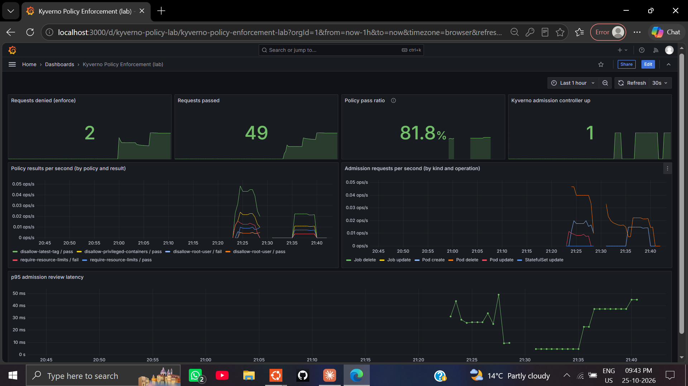
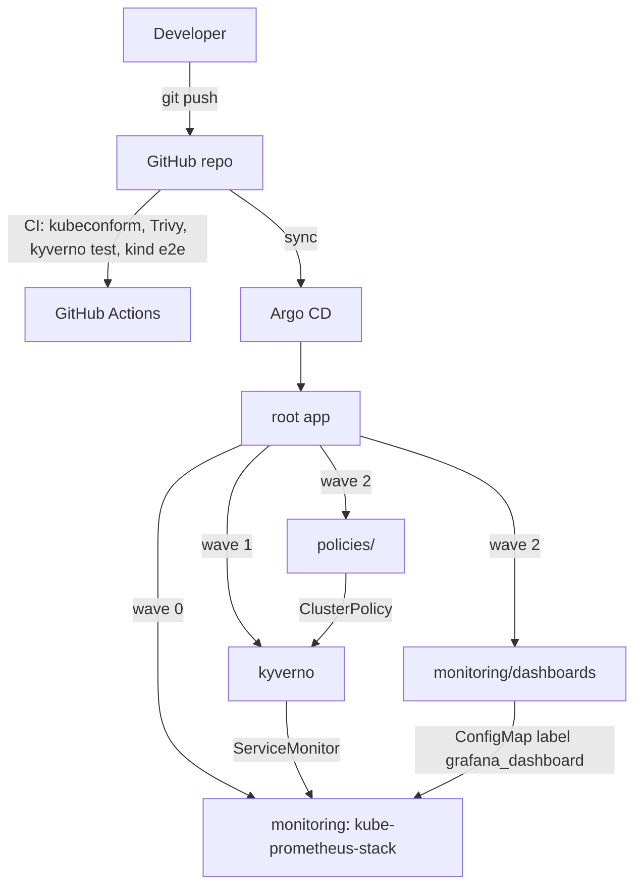

# Kubernetes GitOps, Policy & Observability Lab

[](https://github.com/Danishwani1999/k8s-gitops-observability/actions/workflows/ci.yml)
[](LICENSE)

A hands-on **lab** (single-node Minikube) that combines GitOps delivery, admission-time policy
enforcement and metrics. Argo CD installs and syncs everything in the cluster from this repo.
It is a learning/reference project, not a production setup (see [Known limitations](#known-limitations)).



## What it demonstrates

| Area | Tool | How it is used here |
|---|---|---|
| GitOps | Argo CD v2.13.3 | App-of-apps: one root app installs monitoring, Kyverno, policies and dashboards |
| Policy as code | Kyverno | 4 ClusterPolicies: `disallow-root-user` (**Enforce**), plus 3 in **Audit** |
| Shift-left security | Trivy, kubeconform, Kyverno CLI | Run in CI and locally |
| Metrics | kube-prometheus-stack | Prometheus scrapes Kyverno through ServiceMonitors |
| Dashboards | Grafana | Dashboard JSON stored in Git, loaded by the Grafana sidecar |

## Architecture



## Repository layout

```
argocd/root-app.yaml                  app-of-apps entry point (the only manifest applied by hand)
argocd/apps/                          monitoring, kyverno, policies, dashboards Applications
charts/                               Helm values for kyverno and kube-prometheus-stack
policies/                             Kyverno ClusterPolicies (synced by Argo CD)
monitoring/dashboards/                Grafana dashboard JSON + kustomization (synced by Argo CD)
tests/                                test pods + offline Kyverno test (NEVER synced to the cluster)
scripts/versions.env                  pinned versions
scripts/run-all.sh                    bootstrap: Minikube -> Argo CD -> root app -> tests
scripts/scan-and-test.sh              Trivy + kyverno test + live admission test
scripts/live-test.sh                  live deny/allow check (fails on any error)
scripts/collect-evidence.sh           captures real metrics/sync status into docs/evidence/
.github/workflows/ci.yml              schema, Trivy, Kyverno unit tests, kind e2e
```

## Run it

Prerequisites: Docker, Minikube, kubectl, Trivy, Kyverno CLI (versions in `scripts/versions.env`).
Recommended: 3+ CPUs and 5+ GB RAM given to Docker/WSL.

```bash
./scripts/run-all.sh           # first run: 15-30 min depending on your network
./scripts/collect-evidence.sh  # writes real output to docs/evidence/
```

Grafana: `kubectl -n monitoring port-forward svc/monitoring-grafana 3000:80`.
Credentials: read them from the secret `monitoring-grafana` in the `monitoring` namespace
(lab only; change them before exposing anything).

## Verification (results from my cluster)

Environment: Minikube v1.38.1, Kubernetes v1.35.1, Argo CD v2.13.3, Kyverno chart 3.3.4,
kube-prometheus-stack 67.4.0, Trivy 0.75.0, Kyverno CLI 1.13.4.

**`./scripts/scan-and-test.sh`**

```
Trivy: 14 manifests scanned, 0 HIGH/CRITICAL misconfigurations
Kyverno CLI: 2 tests passed, 0 failed
Live: PASS: Kyverno blocked the root pod.
Live: PASS: hardened pod admitted and running.
All checks passed.
```

**Real Kyverno metrics** (`kyverno_policy_results_total`, one run; counters reset when the controller restarts):

```
disallow-root-user              fail 2   pass 1
require-resource-limits         fail 2   pass 2   (Audit)
disallow-latest-tag             pass 8            (Audit)
disallow-privileged-containers  pass 4            (Audit)
kyverno_admission_requests_total: Pod create 6, Pod delete 6
```

p95 admission review latency in the dashboard: roughly 10-45 ms.
Raw output is in [`docs/evidence/`](docs/evidence/).

The dashboard's "Policy pass ratio" is pass / (pass + fail) over admission decisions. It is **not** a cluster
compliance score, because Audit-mode failures are included.

## Design decisions

- **App-of-apps.** Monitoring, Kyverno and policies are all declared in Git. Sync waves order them:
  monitoring (CRDs) -> Kyverno -> policies.
- **System namespaces excluded** from the root policy (`kube-system`, `kyverno`, `argocd`, `monitoring`)
  so enforcement cannot block the platform itself.
- **`tests/` is never synced.** The failing fixture must not reach the cluster.
- **Multi-source Applications.** Helm chart from its repo, values from this repo.
- **Only Kyverno's admission controller runs.** Background, reports and cleanup controllers are disabled
  to fit a 3-CPU lab; admission enforcement is unaffected.

## Troubleshooting (issues hit while building this)

| Symptom | Cause | Fix |
|---|---|---|
| Apps `Unknown`: `.status.terminatingReplicas: field not declared in schema` | Argo CD 2.13 vs Kubernetes 1.35 | Enable server-side diff (`controller.diff.server.side=true`) |
| `helm pull ... timeout after 1m30s` | Slow network, 90 s default | `ARGOCD_EXEC_TIMEOUT=10m` on the repo-server |
| Kyverno restarts every ~100 s with exit code 0 | Liveness probes time out on a CPU-starved node | Relaxed probes in `charts/kyverno-values.yaml` |
| `failed calling webhook ... connection refused` | Kyverno webhooks fail closed while its controller is down | Wait for the admission controller; start components in stages |
| Load average 30+ on 3 CPUs | Argo CD diffs + Prometheus + Kyverno at once | Fewer Kyverno controllers, slower Argo reconcile, staged start |
| `bitnami/kubectl` ImagePullBackOff | Bitnami removed its free images | Disable Kyverno `cleanupJobs` |

## Known limitations

- Single-node Minikube; Kyverno runs one replica and Argo CD is not HA.
- Only `disallow-root-user` is enforced and unit-tested; the other three policies are in Audit mode.
- Grafana uses the chart's admin credentials (lab only); Alertmanager is disabled.
- Argo CD server-side diff is a workaround for the Kubernetes 1.35 / Argo CD 2.13 mismatch; upgrading
  Argo CD or using an older Kubernetes removes the need for it.
- CI actions use version tags; pin to commit SHAs for supply-chain hardening.

## Author

Danish Ahmad Wani - DevOps & Cloud (fresher). [GitHub](https://github.com/Danishwani1999)
